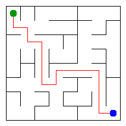

# Assignment 3. Maze Escape

Student ID:250593

Name:Alisher Kairov

Group:SE-2519

Maze size (rows x columns): 8 x 8

This file is the report. Fill it in as you go. How to start: `START_HERE.md`. The task: `docs/Assignment3.pdf`.

## Program output

    Broken: 63
    Kept: 49
    Last broken wall: 89
    MST cost: 16867
    Heaviest broken wall: 752
    Path length: 16
    DFS visited: 41
    Dead ends: 22
    Zones: 64
    Largest zone: 1
    Is DAG: 1
    Flow stages: 16
    Fastest route cost: 7

My maze:

## Questions

Mission 0. find returns the root of the group containing a cell. union joins two different groups. Path compression makes future searches faster, and union by size keeps the trees short.

Mission 1. There are R * C cells, and connecting them without cycles needs exactly R * C - 1 broken walls. The total number of inner walls is R*(C-1) + C*(R-1). Subtracting the broken walls gives (R-1)*(C-1) walls that stay.

Mission 2. Kruskal and Prim both give an MST cost of 16867. Both algorithms connect all cells without cycles and find the smallest possible total cost.

Mission 3. The maze is connected and has no cycles, so there is exactly one path between any two cells. I used a stack stored in an array instead of recursive calls, so a large maze does not overflow the Java call stack.

Mission 4. The reversed graph keeps the same strongly connected zones. With the finishing order from the first pass, the second pass finds one zone at a time without entering another unassigned zone. Since there are no self-loops, the graph has no cycles exactly when every cell is a separate zone.

Mission 5. Kosaraju numbers the zones so that every edge between different zones goes from a smaller number to a larger number. This means all previous results are ready when we process a zone. The pass takes O(n + m) time, where n is the number of cells and m is the number of slides.

## AI use

none

## Timing (Mission 7)

| maze        | Kruskal | Prim |
|-------------|---------|------|
| 100 x 100   | 35      | 27   |
| 300 x 300   | 104     | 213  |
| 1000 x 1000 | 1733    | 5064 |

Both algorithms take more time as the maze gets larger because there are more cells and walls to process. In my tests, Kruskal was faster than Prim on the larger mazes. For the 1000 x 1000 maze, Prim took about three times as long as Kruskal.

## Complexity

n is the number of cells, m the number of walls (or slides). Fill in every algorithm you wrote.

| algorithm               | time              | space | assumptions |
|-------------------------|-------------------|-------|-------------|
| DSU find and union      | O(a(n)) amortized |    O(n)   |        Path compression and union by size; space is for the whole DSU      |
| Kruskal                 |       O(n + m log m)            |    O(n + m)   |      Sort all walls, then use DSU       |
| Prim                    |           O(n + m log m)        |   O(n + m)    |     Connected maze; priority queue stores walls        |
| DFS                     |          O(n + m)         |   O(n + m)    |       Array stack; each cell has at most 4 neighbours      |
| Kosaraju                |           O(n + m)        |   O(n + m)    |      Two iterative DFS passes with adjacency lists       |
| Route in the zone graph |         O(n + m)          |    O(n + m)   |        Process zones in topological order     |

